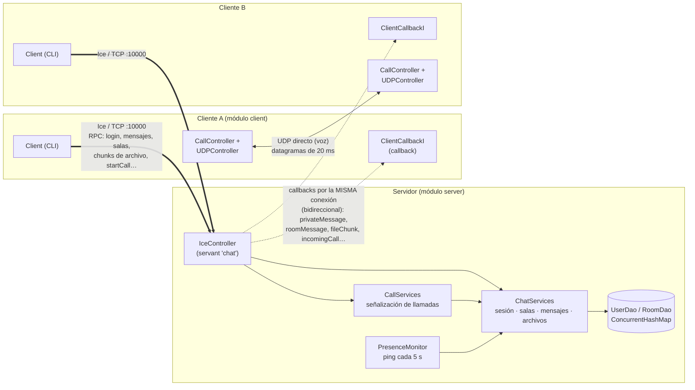
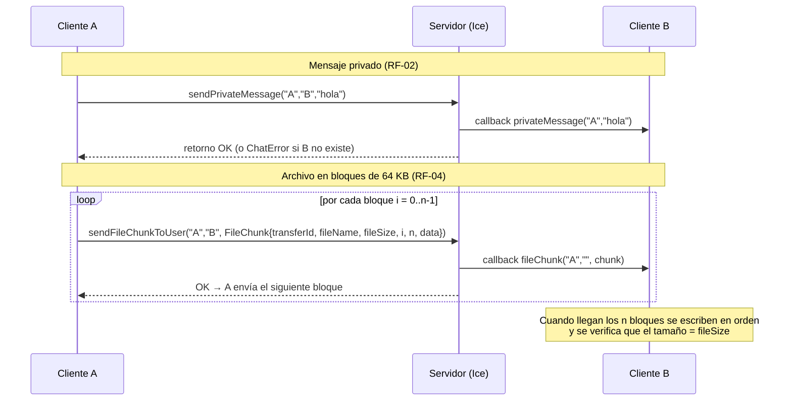
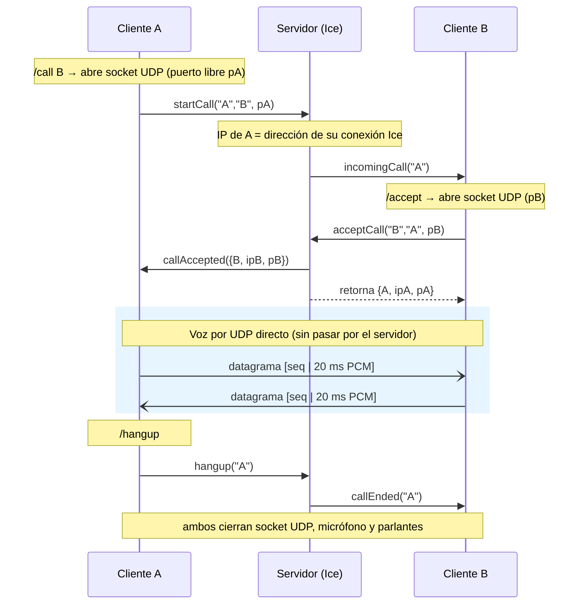
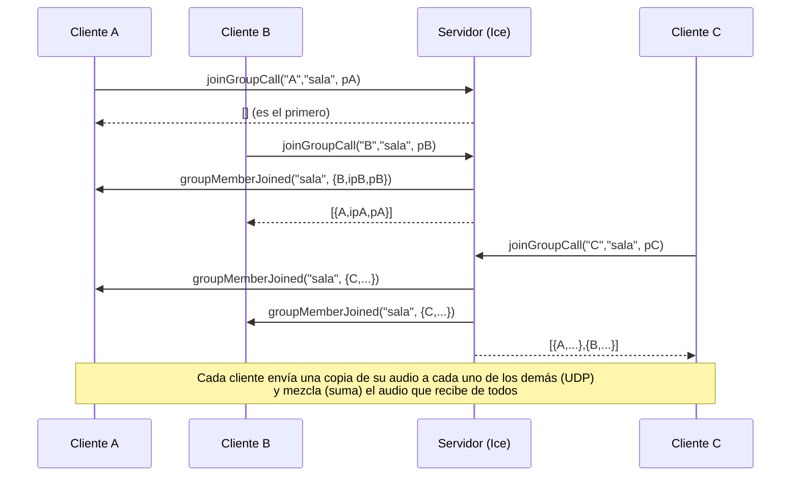

# Chat Multimedia y Voz UDP con ZeroC Ice

**Computación en Internet I (09810 - TIC) · Universidad Icesi · Taller Evaluativo · Período 2026-2**

Plataforma distribuida de comunicación en tiempo real (al estilo de Discord, Slack o Telegram) construida en Java. Combina dos canales de red:

| Canal | Tecnología | Qué transporta |
|---|---|---|
| **Control y datos** | ZeroC Ice 3.7 sobre TCP | Sesión, presencia, mensajes privados y de sala, transferencia de archivos (chunking) y **señalización** de llamadas |
| **Voz en tiempo real** | `DatagramSocket` (UDP) | Audio PCM capturado con `javax.sound.sampled`, directo entre clientes |

**Integrantes:** Daniel Bautista, Jeanfer Rivera, Jhoan Delgado

---

## Tabla de contenido

1. [Arquitectura del sistema](#1-arquitectura-del-sistema)
2. [Estructura del proyecto](#2-estructura-del-proyecto)
3. [Compilación y ejecución](#3-compilación-y-ejecución)
4. [Manual de usuario (CLI)](#4-manual-de-usuario-cli)
5. [Decisiones de diseño](#5-decisiones-de-diseño)
6. [Cuestionario de análisis conceptual](#6-cuestionario-de-análisis-conceptual)

---

## 1. Arquitectura del sistema

### 1.1 Vista general



- **Línea gruesa (Ice/TCP):** cada cliente abre **una sola conexión TCP** al servidor (puerto 10000). Por ella viajan sus invocaciones RPC.
- **Línea punteada (callbacks):** el servidor notifica a los clientes **por esa misma conexión** (conexión bidireccional). El cliente no abre ningún puerto TCP propio.
- **Doble flecha (UDP):** el audio va **directo entre clientes**. El servidor nunca toca el audio, solo reparte las direcciones (IP:puerto UDP) por Ice.

### 1.2 Flujo Ice: mensajes y archivos



### 1.3 Flujo de una llamada 1 a 1: señalización Ice + voz UDP



### 1.4 Llamada grupal (RF-06): malla P2P



---

## 2. Estructura del proyecto

Proyecto **Gradle multimódulo** con el plugin oficial `com.zeroc.gradle.ice-builder.slice`.

```
taller_chat_ice/
├── settings.gradle            ← include 'client', 'server', 'common'
├── build.gradle               ← configuración común de los subproyectos
├── common/                    ← CONTRATO compartido
│   ├── build.gradle           ← plugin ice-builder + dependencia com.zeroc:ice:3.7.10
│   └── src/main/slice/Chat.ice
├── server/
│   ├── build.gradle           ← application (mainClass = Server)
│   └── src/main/java/
│       ├── Server.java                    ← arranque: Communicator, adapter :10000
│       ├── controllers/IceController.java ← servant de ChatServer
│       ├── services/ChatServices.java     ← sesión, presencia, salas, mensajes, archivos
│       ├── services/CallServices.java     ← señalización de llamadas 1 a 1 y grupales
│       ├── services/PresenceMonitor.java  ← detecta clientes caídos
│       ├── daos/                          ← UserDao, RoomDao (ConcurrentHashMap)
│       └── model/                         ← User, Room, Call, GroupCall
└── client/
    ├── build.gradle           ← application (mainClass = Client) + tarea audioTest
    └── src/main/java/
        ├── Client.java                       ← conexión, login y CLI
        ├── controllers/ClientCallbackI.java  ← servant de ClientCallback
        ├── controllers/CallController.java   ← estado de llamadas (une Ice + UDP)
        ├── controllers/UDPController.java    ← socket UDP y destinos del audio
        ├── audio/                            ← AudioConfig, AudioSender, AudioReceiver, AudioTest
        ├── files/                            ← FileSender, FileReceiver (chunking)
        └── ui/Console.java                   ← impresión sincronizada
```

### Contrato Slice (`Chat.ice`)

| Elemento | Propósito |
|---|---|
| `struct FileChunk` | Bloque de archivo con metadatos: `transferId`, `fileName`, `fileSize`, `index`, `totalChunks`, `data` (`sequence<byte>`) |
| `struct AudioEndpoint` | Dirección UDP de un participante: `nickname`, `host`, `port` |
| `exception NicknameInUse` | Nickname ya usado por otra sesión activa (RF-01) |
| `exception ChatError` | Error de negocio con mensaje descriptivo (`reason`) |
| `interface ChatServer` | Operaciones cliente → servidor: sesión, mensajes, salas, archivos y señalización de llamadas |
| `interface ClientCallback` | Notificaciones servidor → cliente: presencia, mensajes, bloques de archivo, eventos de llamada y `ping` |

---

## 3. Compilación y ejecución

### Requisitos

- **JDK 17 o superior**
- **ZeroC Ice 3.7** instalado (el plugin de Gradle necesita el compilador `slice2java`). Verificar con `slice2java --version`.
- Micrófono y parlantes o audífonos para las llamadas.

### Compilar

Desde la carpeta `taller_chat_ice`:

```
.\gradlew build installDist
```

`installDist` genera ejecutables en `server/build/install` y `client/build/install`. Hay que volver a correrlo después de cada cambio de código.

### Ejecutar

**Servidor:**
```
.\server\build\install\server\bin\server.bat
```
o bien `.\gradlew :server:run`.

**Cliente** (uno por terminal o por PC):
```
.\client\build\install\client\bin\client.bat
```
o bien `.\gradlew :client:run --console=plain`.

El cliente pide la **IP del servidor** (Enter = `localhost`) y luego un **nickname**.

**Prueba del audio sin servidor** (el cliente se envía audio a sí mismo por UDP):
```
.\gradlew :client:audioTest --console=plain
```

### Ejecución entre varios PCs

1. En el PC del servidor, obtener la IP de red con `ipconfig` (Dirección IPv4, por ejemplo `192.168.1.15`).
2. En los clientes, escribir esa IP cuando la pidan.
3. Permitir Java en el **Firewall de Windows** (redes privadas) en todos los PCs; de lo contrario el audio UDP puede no llegar.

### Parámetros de Ice

Las propiedades de Ice se pueden pasar por línea de comandos. Por ejemplo, para cambiar el límite de tamaño de mensaje:
```
.\gradlew :server:run --args="--Ice.MessageSizeMax=2048"
```
Por defecto `Ice.MessageSizeMax = 1024 KB`. Los bloques de archivo de 64 KB quedan muy por debajo de ese límite.

---

## 4. Manual de usuario (CLI)

La interfaz es una consola interactiva. El hilo que lee los comandos está separado de los hilos de Ice que imprimen los mensajes entrantes, así que **puedes recibir mensajes mientras escribes**. Las líneas no se mezclan porque toda la salida pasa por `Console`, que está sincronizada.

### Sesión y presencia

| Comando | Descripción |
|---|---|
| *(al iniciar)* | Se pide el nickname; si ya está en uso se pide otro |
| `/users` | Lista los usuarios conectados |
| `/logout` | Cierra sesión de forma ordenada y sale |
| `/help` | Muestra todos los comandos |

La lista de conectados también llega **automáticamente** cada vez que alguien entra o sale: `Conectados (3): santi, pedro, ana`.

### Mensajes

| Comando | Descripción | Ejemplo |
|---|---|---|
| `/msg <usuario> <texto>` | Mensaje privado | `/msg pedro hola, ¿cómo vas?` |
| `/room <sala> <texto>` | Mensaje a una sala (llega a todos los miembros menos a ti) | `/room grupo buenas a todos` |

Formato de los mensajes recibidos: `[Privado] pedro: hola` y `[#grupo] ana: buenas`.

### Salas

| Comando | Descripción |
|---|---|
| `/create <sala>` | Crea una sala; quedas dentro automáticamente |
| `/rooms` | Lista las salas existentes |
| `/join <sala>` | Te une a una sala (puedes estar en varias) |
| `/leave <sala>` | Sales de una sala (y de su llamada grupal si estabas en ella) |

### Archivos

| Comando | Descripción |
|---|---|
| `/sendfile <usuario> <ruta>` | Envía un archivo en privado |
| `/sendfile #<sala> <ruta>` | Envía un archivo a todos los miembros de una sala |

- Si la ruta tiene espacios, escríbela entre comillas: `/sendfile pedro "C:\Mis fotos\foto 1.png"`.
- El envío corre en segundo plano: puedes seguir chateando mientras se transfiere.
- Los archivos recibidos se guardan en `archivos_recibidos/<tu_nickname>/`. Si el nombre ya existe se guarda como `nombre (1).ext`.

### Llamadas de voz 1 a 1

| Comando | Descripción |
|---|---|
| `/call <usuario>` | Llama a un usuario |
| `/accept [usuario]` | Acepta la llamada entrante (el nombre es opcional si solo te llama una persona) |
| `/reject [usuario]` | Rechaza la llamada entrante |
| `/hangup` | Cuelga, o cancela si todavía está sonando |
| `/mute` / `/unmute` | Silencia o activa tu micrófono |

### Llamadas grupales (por sala)

| Comando | Descripción |
|---|---|
| `/groupcall <sala>` | Entra a la llamada de voz de una sala; si no hay nadie, la inicia |
| `/leavecall` | Sale de la llamada grupal sin afectar a los demás (`/hangup` también sirve) |
| `/mute` / `/unmute` | Silencia o activa tu micrófono |

**Reglas:** solo puedes estar en **una** llamada a la vez (1 a 1 o grupal), y solo los miembros de una sala pueden entrar a su llamada.

### Ejemplo de sesión

```
santi> /create grupo
santi> /msg pedro ¿entras a #grupo?
pedro> /join grupo
pedro> /room grupo listo
santi> /sendfile #grupo "C:\docs\informe.pdf"
santi> /call pedro
pedro> /accept
santi> /mute
santi> /unmute
pedro> /hangup
santi> /groupcall grupo
pedro> /groupcall grupo
pedro> /leavecall
santi> /logout
```

> **Recomendación:** usa **audífonos** durante las llamadas. Si dos clientes están en el mismo PC con parlantes, el micrófono capta el audio reproducido y se produce eco o pitido.

---

## 5. Decisiones de diseño

### 5.1 Concurrencia segura en el servidor (thread-safety)

- El servidor usa un pool de hilos de Ice de **4 a 16 hilos** (`Ice.ThreadPool.Server.Size/SizeMax`). Varias invocaciones se ejecutan al mismo tiempo, y un hilo puede quedar esperando la respuesta de un callback mientras otros siguen atendiendo.
- **Estado global** en `ConcurrentHashMap` (usuarios, salas, llamadas 1 a 1 y grupales). `UserDao.save` usa `putIfAbsent`, que es atómico, así que dos logins simultáneos con el mismo nickname no pueden registrarse los dos.
- `Room` y `GroupCall` protegen sus listas internas con `synchronized` y devuelven **copias** al consultarlas.
- **Patrón "validar adentro, notificar afuera":** en `ChatServices` y `CallServices`, la validación y la modificación del estado se hacen dentro de `synchronized(this)`, pero los **callbacks a los clientes se invocan fuera del candado**. Así un cliente lento no bloquea todo el servidor y se evitan *deadlocks*.
- `ChatServices` y `CallServices` se consultan entre sí **sin tener nunca los dos candados a la vez**, lo que elimina la posibilidad de un deadlock entre ellos.
- **Difusión asíncrona:** los mensajes de sala, los bloques de archivo a salas y las notificaciones de presencia usan `…Async()` (por ejemplo `roomMessageAsync`). Se envían a todos los destinatarios en paralelo y luego se espera el resultado; un destinatario lento no retrasa a los demás.

### 5.2 Presencia y tolerancia a fallos

- `PresenceMonitor` (hilo daemon) hace `ping()` a cada cliente cada **5 s**, con `ice_invocationTimeout(2000)`. Si falla, el usuario se elimina de salas y llamadas y se notifica la nueva lista a todos.
- `removeDisconnectedUser` compara la **instancia** del `User`, no solo el nombre. Así, si alguien se cayó y se reconectó rápido con el mismo nickname, no se borra su sesión nueva.
- Al hacer logout, al caerse o al salir de una sala, las llamadas del usuario se terminan y los demás participantes reciben `callEnded` o `groupMemberLeft`.

### 5.3 Transferencia de archivos

- Bloques de **64 KB** (`FileSender.CHUNK_SIZE`). Cada `FileChunk` lleva `transferId` (UUID), nombre, tamaño total, índice y total de bloques.
- El emisor envía de forma **síncrona** bloque por bloque. Eso mantiene el orden y regula el flujo (no se envía el siguiente hasta que el servidor reenvió el anterior).
- El receptor guarda cada bloque **en la posición de su índice**, valida que los metadatos sean coherentes, verifica al final que el tamaño escrito sea igual a `fileSize` y descarta las transferencias que pasen 60 s sin recibir bloques.

### 5.4 Señalización de llamadas

- El cliente solo informa su **puerto** UDP. La **IP** la obtiene el servidor de la conexión Ice (`current.con`), así no depende de que el cliente conozca su propia IP (un PC puede tener varias interfaces). Si el cliente está en el mismo PC que el servidor (`127.0.0.1`), se usa la IP de red local del servidor.

### 5.5 Canal de voz UDP

| Parámetro | Valor | Motivo |
|---|---|---|
| Formato | PCM 16 kHz, 16 bits, mono | Calidad suficiente para voz, unos 32 KB/s por emisor |
| Paquete | 20 ms = 640 bytes de audio + 4 bytes de número de secuencia | Equilibrio entre latencia y cantidad de paquetes (50 paquetes/s) |
| Orden | Se descartan los paquetes con secuencia vieja o repetida | UDP puede desordenar o duplicar |
| Retraso máximo | Cola de 10 paquetes (200 ms) por emisor; si se llena, se descarta lo más viejo | Evitar que el retraso se acumule |
| Mezcla | Se suman las muestras de todos los emisores, con recorte (*clipping*) | En grupal se escucha a todos a la vez |

- **Hilos del cliente:** captura y envío (`AudioSender`), recepción (`AudioReceiver`), reproducción y mezcla (`AudioReceiver`), además del hilo de la consola y los hilos de Ice.
- El mismo `DatagramSocket` se usa para enviar y recibir, así el puerto de origen identifica a cada emisor.
- **Mute:** se sigue leyendo el micrófono, para que su buffer no se llene, pero no se envía nada.

### 5.6 Estrategia de llamada grupal: **Malla P2P (Mesh)**

Se eligió la **malla P2P** en lugar del relay centralizado por estas razones:

1. **El audio no pasa por el servidor.** Hay menos latencia (sin salto intermedio) y el servidor solo hace señalización, lo que mantiene su carga baja y constante.
2. **Reutiliza el diseño 1 a 1.** Una llamada 1 a 1 es una malla de 2. El mismo `AudioSender` envía a una lista de destinos, y el mismo `AudioReceiver` mezcla N emisores.
3. **Contexto de uso:** grupos pequeños (3 a 5 personas) en una misma red local (laboratorio), donde la subida de cada cliente alcanza de sobra y no hay NAT entre los participantes.

Su limitación es que la subida de cada cliente crece con N y el tráfico total crece con N². Para salas grandes o clientes en redes distintas (detrás de NAT), un relay sería la mejor opción (ver pregunta 3).

---

## 6. Cuestionario de análisis conceptual

### 6.1 Arquitectura híbrida TCP/UDP

**¿Por qué el control, el chat y los archivos van por Ice (TCP) y la voz por UDP?**

Los dos tipos de tráfico tienen requisitos opuestos:

| Requisito | Control, chat y archivos | Voz |
|---|---|---|
| Fiabilidad | **Imprescindible**: un mensaje o un bloque perdido es un error | Tolerable: perder 20 ms de audio casi no se nota |
| Orden | **Imprescindible** (por ejemplo, los bloques de un archivo) | Solo importa el audio más reciente |
| Latencia | Puede tolerar algunos cientos de ms | Crítica: más de 150–200 ms dificulta la conversación |
| Tipado y contrato | Muy útil (operaciones, excepciones, structs) | Es un flujo de bytes continuo |

- **Ice sobre TCP** aporta lo que necesita el control: entrega fiable y ordenada (TCP), un **contrato tipado** en Slice (no hay que inventar un protocolo de texto ni serializar a mano), **excepciones remotas** (`NicknameInUse`, `ChatError`) que permiten informar errores descriptivos, confirmación implícita (si la RPC retorna sin excepción, la operación se completó) y **callbacks** para notificaciones *push*.
- **UDP** aporta lo que necesita la voz: cada datagrama se entrega **en cuanto llega**, sin esperar a los anteriores, sin retransmisiones, sin control de congestión que frene el envío y sin la sobrecarga de una petición-respuesta por paquete.

**¿Qué pasaría si la voz fuera por Ice/TCP con jitter o pérdida de paquetes?**

1. **Bloqueo de cabeza de línea (head-of-line blocking).** TCP entrega los bytes en orden. Si se pierde un segmento, **todos los que llegaron después quedan retenidos** en el buffer del receptor hasta que llegue la retransmisión (al menos un RTT más, a veces el *RTO* completo, que es de cientos de ms). Durante ese tiempo el reproductor no recibe nada y se escucha un **silencio o corte**.
2. **Ráfagas y retraso acumulado.** Después de la retransmisión llegan de golpe todos los paquetes retenidos. El reproductor tiene dos opciones malas: reproducirlos todos (el retraso de la conversación **crece y no se recupera**, y la llamada se vuelve "de walkie-talkie") o descartarlos (con lo que la retransmisión de TCP no sirvió de nada).
3. **Control de congestión.** Ante una pérdida, TCP **reduce su ventana de envío**. El emisor no puede enviar al ritmo constante de 50 paquetes/s que produce el micrófono y el audio se atrasa todavía más.
4. **Sobrecarga de RPC síncrona.** Con una invocación Ice por cada paquete de 20 ms, cada envío espera la respuesta del servidor (un RTT). Con jitter, el tiempo entre paquetes deja de ser regular y ocupa hilos del pool de Ice. Si el RTT supera los 20 ms, el emisor **no alcanza a enviar en tiempo real**.
5. **Consecuencia acústica:** audio **entrecortado**, retraso creciente, voz "robótica" o acelerada cuando se intenta recuperar el retraso, y en llamadas grupales desincronización entre participantes.

Con UDP, en cambio, un paquete perdido es solo un hueco de 20 ms. Nuestro receptor además **descarta los paquetes viejos o desordenados** (por número de secuencia) y **limita la cola a 200 ms**, de modo que el retraso nunca se acumula.

### 6.2 Manejo de buffer y chunking en Ice

**¿Qué pasa si se envía un video de 80 MB en una sola RPC con `sequence<byte>`?**

Ice limita el tamaño de cada mensaje del protocolo con la propiedad **`Ice.MessageSizeMax`**, que por defecto vale **1024 KB (1 MB)**. Un mensaje de unos 80 MB supera ese límite por mucho y Ice lanza **`com.zeroc.Ice.MemoryLimitException`**. El lado que recibe el mensaje lo rechaza y cierra la conexión, así que el emisor ve la invocación fallar con esa excepción, o con un error de conexión según el punto en que se detecte. La transferencia completa se pierde.

Aunque se subiera el límite, el diseño seguiría siendo malo:

- Hay que tener **los 80 MB completos en memoria** en el emisor, en el servidor (que lo reenvía) y en el receptor, a la vez.
- Una sola invocación **ocupa un hilo y la conexión** durante todo el envío, y en ese tiempo no pueden pasar mensajes de chat ni pings. El `PresenceMonitor` podría incluso considerar caído al cliente.
- Si la red falla al 99 %, **no hay forma de recuperar** lo ya enviado ni de mostrar progreso.

**¿Cómo lo resuelve el chunking?**

El archivo se divide en **bloques de 64 KB**, y cada uno se envía en una invocación independiente con sus metadatos (`FileChunk`):

| Campo | Para qué |
|---|---|
| `transferId` | Distingue transferencias simultáneas (UUID) |
| `fileName` | Nombre con el que se guarda |
| `fileSize` | Tamaño total, para verificar la integridad al final |
| `index` / `totalChunks` | Posición del bloque y cuántos son; permite reconstruir aunque lleguen desordenados y saber cuándo terminó |
| `data` (`sequence<byte>`) | Los bytes del bloque |

Así, cada mensaje mide unos 64 KB, siempre muy por debajo de `Ice.MessageSizeMax`, sin importar si el archivo pesa 1 MB u 80 MB (80 MB son 1280 bloques). El emisor lee el archivo del disco de a un bloque, sin cargarlo entero en memoria. Entre bloques, la conexión queda libre para otros mensajes. Y el envío síncrono bloque a bloque actúa como **control de flujo**, porque el emisor no avanza más rápido de lo que el servidor puede reenviar.

**Parámetros de configuración de Ice que intervienen:**

- **`Ice.MessageSizeMax`** (en KB): límite de tamaño de mensaje. Valor por defecto 1024. Un valor menor o igual a 0 desactiva el límite (no recomendado). Debe ser mayor que el tamaño del bloque más la cabecera del protocolo. Ice 3.7 también permite fijarlo por adaptador (`<Adaptador>.MessageSizeMax`).
- **`Ice.ThreadPool.Server.Size` / `SizeMax`**: hilos disponibles para despachar invocaciones. Mientras un hilo reenvía un bloque, los demás siguen atendiendo.
- **Timeouts de invocación** (`Ice.Override.Timeout`, o `ice_invocationTimeout` por proxy): limitan cuánto puede tardar el envío de cada bloque, para detectar un receptor que dejó de responder.

### 6.3 Escalabilidad en llamadas grupales: relay vs mesh

Supuestos: **N** participantes, todos hablando al mismo tiempo, y cada cliente genera **1 paquete cada 20 ms** (**50 paquetes/s**). Cada paquete mide unos 672 bytes en la red: 644 de datos más 28 de cabeceras IP y UDP. Eso da unos **33,6 KB/s por flujo**.

**Mesh P2P (nuestra elección):**

- **Cada cliente emite N − 1 paquetes** por cada intervalo de 20 ms, uno para cada uno de los demás, es decir **50·(N−1) paquetes/s** de subida.
- Cada cliente recibe N − 1 flujos y los mezcla localmente.
- **Carga en el servidor: 0 paquetes de audio.** Solo atiende la señalización por Ice (unos pocos mensajes al entrar y salir).
- Tráfico total en la red: **N·(N−1)** paquetes cada 20 ms.

**Relay centralizado (SFU ligero):**

- **Cada cliente emite 1 paquete** por intervalo (**50 paquetes/s**), solo hacia el servidor, sin importar N.
- **El servidor recibe N** paquetes y **reenvía N·(N−1)** paquetes por intervalo, porque cada voz va a los otros N−1. Su salida es **50·N·(N−1) paquetes/s**.
- Cada cliente recibe N − 1 flujos (o solo 1 si el servidor mezclara el audio, como un MCU, a cambio de mucho más CPU en el servidor).

**Ejemplo numérico:**

| | N = 3 | N = 5 | N = 10 |
|---|---|---|---|
| **Mesh:** paquetes/s que emite cada cliente | 100 (~67 KB/s) | 200 (~134 KB/s) | 450 (~302 KB/s) |
| **Mesh:** paquetes/s de audio en el servidor | 0 | 0 | 0 |
| **Relay:** paquetes/s que emite cada cliente | 50 (~34 KB/s) | 50 | 50 |
| **Relay:** paquetes/s que **recibe** el servidor | 150 | 250 | 500 |
| **Relay:** paquetes/s que **envía** el servidor | 300 (~202 KB/s) | 1000 (~672 KB/s) | 4500 (~3 MB/s) |
| **Mesh:** tráfico total de audio en la red (paquetes/s) | 300 | 1000 | 4500 |
| **Relay:** tráfico total (entrada + salida del servidor) | 450 | 1250 | 5000 |

**Comparación:**

| Aspecto | Mesh P2P | Relay centralizado |
|---|---|---|
| Subida de cada cliente | Crece con N (O(N)) | Constante (O(1)) |
| Carga de red del servidor | Nula (solo señalización) | Crece con N² (O(N²) de salida) |
| Latencia | Menor (directo, un solo salto) | Mayor (cliente → servidor → cliente) |
| Punto único de falla | No para el audio | Sí: si el relay cae, cae la llamada |
| NAT y firewalls | Problemático: cada par debe poder alcanzarse | Simple: los clientes solo hablan con el servidor |
| Complejidad del servidor | Baja | Mayor (socket UDP, tabla de reenvío por sala) |
| Escala adecuada | Grupos pequeños (≤ 5–6) en LAN | Grupos medianos o grandes, Internet |

**Conclusión:** en ambas topologías el tráfico total crece como N·(N−1). La diferencia es **quién lo soporta**: en mesh se reparte entre los clientes, y en relay se concentra en el servidor. Para nuestro escenario (laboratorio, LAN, grupos pequeños), mesh da menor latencia y un servidor más simple. Si el sistema tuviera que escalar a muchos participantes o funcionar por Internet, convendría un relay, idealmente uno que mezcle el audio (MCU) o que solo reenvíe a quien está hablando.

### 6.4 Transparencia y callbacks en Ice

**Ciclo de vida y configuración del adaptador en el cliente** (ver `Client.java`):

1. **Crear el Communicator:** `Util.initialize(args)` inicializa el runtime de Ice del cliente (hilos, conexiones, propiedades).
2. **Obtener el proxy del servidor:** `ChatServerPrx.checkedCast(communicator.stringToProxy("chat:tcp -h <ip> -p 10000"))`. `checkedCast` contacta al servidor, verifica que el objeto implementa `ChatServer` y **abre la conexión TCP**.
3. **Crear un ObjectAdapter sin endpoints:** `communicator.createObjectAdapter("")`. Un adaptador normalmente escucha en un puerto, pero este **no abre ningún puerto**: solo podrá recibir invocaciones que lleguen por conexiones que el cliente ya abrió. Así el cliente funciona aunque esté detrás de un firewall o NAT.
4. **Registrar el servant:** `adapter.add(new ClientCallbackI(...), identidad UUID)`. El objeto que implementa `ClientCallback` queda registrado con una identidad única, y `add` devuelve un proxy que lo referencia.
5. **Activar el adaptador:** `adapter.activate()`. Desde aquí puede despachar invocaciones.
6. **Asociar el adaptador a la conexión (bidireccional):** `chat.ice_getConnection().setAdapter(adapter)`. Le indica a la conexión TCP que, si el servidor envía peticiones por ella, las despache a este adaptador. Este paso convierte la conexión en **bidireccional**.
7. **Enviar el proxy en el login:** `chat.login(nickname, ClientCallbackPrx.uncheckedCast(prx))`. Se usa `uncheckedCast` porque es un objeto local conocido; no tiene sentido verificarlo de forma remota.
8. **En el servidor:** `callback.ice_fixed(current.con)` crea un **proxy fijo**, amarrado a la conexión por la que llegó el login, y se guarda en el `User`. Cada `callback.privateMessage(...)` viaja de vuelta **por esa misma conexión TCP**, y el cliente lo ejecuta en uno de sus hilos de Ice.
9. **Fin del ciclo:** con `/logout` el servidor elimina al usuario y su proxy. Luego el `try-with-resources` cierra el Communicator, lo que destruye el adaptador y cierra la conexión. Si el cliente se cae sin logout, el `ping()` del `PresenceMonitor` falla y el servidor lo elimina.

**Proxies directos vs indirectos:**

- **Proxy directo:** contiene la identidad del objeto **y sus endpoints** (protocolo, host y puerto), por ejemplo `chat:tcp -h 192.168.1.15 -p 10000`. El cliente sabe exactamente a dónde conectarse. **Es el que usa nuestro cliente para llegar al servidor.**
- **Proxy indirecto:** contiene solo la identidad (`chat`), o la identidad más un *adapter id* (`chat@ChatAdapter`). Para usarlo, Ice consulta a un **servicio de localización** (*Locator*, por ejemplo IceGrid), que resuelve en tiempo de ejecución dónde está el objeto. Esto da **transparencia de ubicación**: el servidor puede cambiar de máquina o puerto sin que los clientes cambien nada. **No lo usamos**, porque no hay IceGrid y el servidor tiene IP y puerto conocidos.
- **El proxy del callback no es ni directo ni indirecto en la práctica.** Como el adaptador del cliente no tiene endpoints, el proxy que se envía en `login` no indica cómo llegar al cliente. Un proxy directo hacia el cliente obligaría a que el cliente abriera un puerto accesible desde el servidor, lo que falla con NAT y firewalls. Por eso el servidor lo convierte en un **proxy fijo** (`ice_fixed`), atado a una conexión existente en vez de a una dirección. Esta es la base de las **conexiones bidireccionales** de Ice. Su limitación es que el proxy solo vale mientras esa conexión exista; por eso se detecta su caída con `ping` y se descarta.

En resumen, el cliente usa un **proxy directo** para llegar al servidor, y el servidor usa un **proxy fijo sobre la conexión bidireccional** para llegar al cliente. Gracias a la transparencia de Ice, en ambos casos el código solo invoca métodos sobre un proxy, como si el objeto fuera local.
